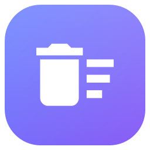

<p align="center">
  
</p>

<h1 align="center">Deep Uninstaller</h1>

<p align="center">
  Desinstalador profundo y limpiador del sistema para Windows, gratuito y de código abierto.
</p>

<p align="center">
  <a href="LICENSE"></a>
  
  
</p>

---

## ¿Qué hace?

Deep Uninstaller ejecuta el desinstalador oficial de un programa y después busca **todo lo que deja atrás**: carpetas, archivos y claves del registro. Antes de borrar nada te muestra la lista completa para que decidas qué eliminar.

### Funciones

- **Lista de programas y juegos instalados** (incluye juegos de Steam), con búsqueda, filtros por tipo y ordenación.
- **Desinstalación profunda**: ejecuta el desinstalador oficial (MSI, NSIS, Inno Setup…) y luego escanea restos en disco y registro.
- **Revisión antes de borrar**: cada resto aparece con un nivel de confianza; puedes marcar todo, solo lo seguro, o elegir a mano.
- **Análisis de riesgo**: detecta carpetas que contienen *otros* programas o launchers (Steam, Epic, Battle.net, EA, Ubisoft, Riot, GOG) y avisa antes de borrarlas.
- **Respaldo del registro**: las claves eliminadas se exportan antes a `Documentos\DeepUninstaller\Respaldos`.
- **Archivos bloqueados**: lo que no se puede borrar en el momento se programa para eliminarse al reiniciar.
- **Limpieza del sistema**: temporales del usuario y de Windows, papelera, caché de Windows Update y más, con opción de seleccionar todo de una vez.
- **Carpetas huérfanas**: encuentra carpetas en `Program Files`, `ProgramData` y `AppData` de programas que ya no están instalados. Omite todo lo que usa un programa, servicio o proceso activo, o que cambió en los últimos 30 días.

> ⚠️ La aplicación requiere permisos de administrador porque borra en `Program Files`, `ProgramData` y `HKLM`. Revisa siempre la lista antes de confirmar.

## Descarga

<a href="https://github.com/ItsFeny/DeepUninstaller/releases/latest"></a>

Descarga la última versión desde [Releases](https://github.com/ItsFeny/DeepUninstaller/releases/latest):

- **`DeepUninstaller-vX.Y.Z-win-x64.exe`** (recomendado): portable, no necesita instalar nada.
- **`DeepUninstaller-vX.Y.Z-win-x64-ligero.exe`**: más pequeño, requiere [.NET 8 Desktop Runtime](https://dotnet.microsoft.com/download/dotnet/8.0).

No requiere instalación: descarga y ejecuta. Windows puede mostrar un aviso de SmartScreen porque el ejecutable no está firmado (**Más información → Ejecutar de todas formas**).

## Compilar desde el código

Requisitos: Windows 10/11 y el [SDK de .NET 8](https://dotnet.microsoft.com/download/dotnet/8.0).

```powershell
git clone https://github.com/ItsFeny/DeepUninstaller.git
cd DeepUninstaller
dotnet build -c Release
```

Para generar un único `.exe` autocontenido:

```powershell
dotnet publish src/DeepUninstaller/DeepUninstaller.csproj -c Release -r win-x64 --self-contained true -p:PublishSingleFile=true -o publish
```

## Estructura del proyecto

```
src/DeepUninstaller/
├── Models/               Datos: InstalledApp, LeftoverItem, CleanTarget...
├── Services/
│   ├── Scanning/         AppScanner, LeftoverScanner, Categorizer, RiskAnalyzer
│   └── Cleaning/         Cleaner (desinstalar y borrar restos), SystemCleaner
├── Infrastructure/       RegUtil (registro), SafePaths (rutas protegidas), Util
├── UI/
│   ├── Views/            MainWindow, Dialog
│   ├── ViewModels/       TreeNode (árbol de revisión), CategoryFilter
│   ├── Themes/Theme.xaml Colores y estilos
│   └── Icons.cs, IconLoader.cs
└── Assets/               Icono de la app y fuente Material Icons
```

Más detalles de arquitectura y convenciones en [CLAUDE.md](CLAUDE.md).

## Contribuir

¡Las contribuciones son bienvenidas! Lee [CONTRIBUTING.md](CONTRIBUTING.md) y el [Código de Conducta](CODE_OF_CONDUCT.md).

## Licencia

Distribuido bajo la licencia [MIT](LICENSE). Los iconos Material Icons son de Google bajo Apache 2.0 — ver [THIRD_PARTY_NOTICES.md](THIRD_PARTY_NOTICES.md).

## Aviso

Este software se ofrece "tal cual", sin garantía. Borrar archivos y claves del registro puede afectar a otros programas; úsalo bajo tu propia responsabilidad.
